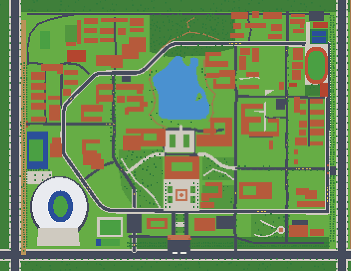

# 像素校园 · 河北工程大学新校区

星露谷风格的俯视角 2D 网页游戏，多人在线（Phaser 3 + TypeScript + Vite 客户端）。**不商用，仅个人学习。** © 2026 [EXIST-D](https://github.com/EXIST-D)，保留所有权利，条款见文末「许可说明」。

- 🎮 **在线游玩**：[https://exist.qd.je/pixel/](https://exist.qd.je/pixel/) （电脑、手机浏览器直接打开，不用下载、不用注册）
- 💬 **交流群**：**1126319323** （玩法反馈、报 bug、想法建议、一起协作开发都欢迎来聊）
- 📦 **项目仓库**：[https://github.com/EXIST-D/PixelCampus](https://github.com/EXIST-D/PixelCampus) （公开；欢迎 fork 提 Pull Request，须经仓库主人审核才合并）

地图**平面布局以真实校园为准**（卫星正射图量测 + OSM 交叉校验：88 栋建筑、道路网、湖、运动场、三个大门；世界 704×544 格，1 格 = 2.5 m）；
画面（地面、建筑、树、人物、小猫、UI）全部由代码程序化生成，没有第三方素材（仅 Ark Pixel 12px 字体，OFL）。



## 快速开始
```bash
npm ci
npm run guide      # 重新生成钓鱼攻略 docs/guide/FISHING_GUIDE.md（改了鱼表/装备/等级/价格后运行）
npm run assets     # 生成地面块 / 图集 / 世界数据（生成物不入库；首次约 2 分钟，之后有缓存）
npm run dev        # http://127.0.0.1:5173/?offline （离线单人预览；?touch 强制手机界面，把窗口调矮就是横屏布局）
npm test           # 客户端与共享规则的测试
npm run build      # 类型检查 + 生产构建
```
**联机服务器、部署和运维不在这个仓库里**，由主人在自己电脑上维护；仓库里的 `npm run server / deploy / board / admin:set / bots` 等脚本需要那部分文件，协作者用不到。

**多人协作**：fork 本仓库、在自己的 fork 里改，提 Pull Request，CI 自动跑检查；主人审核合并，上线部署由主人或主人授权的协作者手动执行（合并不会自动上线）。完整流程见 [docs/process/COLLABORATION.md](docs/process/COLLABORATION.md)。

## 玩法一览
走路/奔跑、骑共享单车、和校园小猫玩（好感度、跟随、猫窝）、湖边钓鱼（拉鱼小游戏、48 种鱼、图鉴）、校园商店卖鱼买东西、校园墙发帖（需管理员审核）、每日任务/成就/称号、校园跑、好友/私聊/组队、公屏/留言板/公告、拍照、表情、手持物、季节与天气、昼夜。
操作：`WASD/方向键` 移动，`Shift` 奔跑，`E/空格` 互动，`I` 背包，`H` 图鉴，`J` 成就，`Q` 任务，`T` 组队，`X` 表情，`P` 拍照，`Z` 沉浸模式，`M` 地图，`B` 留言板，`N` 公告，`F` 好友，`+/-` 缩放；手机是左半屏摇杆 + 右下角按钮。
**完整功能清单见 [docs/FEATURES.md](docs/FEATURES.md)**（每次更新同步），更新历史见 [docs/CHANGELOG.md](docs/CHANGELOG.md)。

## 目录
```
data/campus/        ★ 地图唯一数据源（改这里，再 npm run assets）：geo、terrain、buildings、pois、osm-roads
data/interiors/     室内数据（宿舍室内 + 42 号楼 214 室试点，其余室内未开放）
src/                游戏客户端：scenes / entities / world / systems / ui / audio / net / art（人物小猫 Rig）/ shared（共享规则与协议）
tools/              构建期工具：world/compile.ts（蓝图→地面块+图集+碰撞）、art/（程序化像素美术）、reference/（卫星图对照）、analysis/（Python 路网分析）
tests/              vitest：蓝图完整性、地图保真度、生成世界、外观/协议/共享规则…
docs/               文档（见下）
archive/            上一版（只读，已废弃，不入库）
```

## 文档
- **[docs/HANDOFF.md](docs/HANDOFF.md) — 项目交接：现状、约定、待办、调试手册（新会话/新协作者先读这个）**
- [docs/FEATURES.md](docs/FEATURES.md) 现有功能 · [docs/CHANGELOG.md](docs/CHANGELOG.md) 更新记录
- [docs/guide/FISHING_GUIDE.md](docs/guide/FISHING_GUIDE.md) 钓鱼攻略（玩家手册，表格由 `npm run guide` 从真实规则生成）
- [docs/process/COLLABORATION.md](docs/process/COLLABORATION.md) 协作流程（fork + PR）
- [docs/README.md](docs/README.md) **文档索引（每份文档是什么、状态、怎么维护）** · [docs/feature/](docs/feature/spec.md) 新功能的需求（spec）+ 计划（plan）模板
- [docs/architecture/ARCHITECTURE.md](docs/architecture/ARCHITECTURE.md) 架构 · [docs/architecture/PROTOCOL.md](docs/architecture/PROTOCOL.md) 联机协议索引（自动生成）· [docs/design/MULTIPLAYER.md](docs/design/MULTIPLAYER.md) 联机各批功能的设计记录 · [docs/design/ECONOMY.md](docs/design/ECONOMY.md) 货币/商店/校园墙设计
- [docs/map/MAP_PIPELINE.md](docs/map/MAP_PIPELINE.md) 地图管线与已知偏差（改地图前先读）· [docs/map/SCALE.md](docs/map/SCALE.md) 比例约定
- [docs/art/ART_STYLE.md](docs/art/ART_STYLE.md) 美术风格 · [docs/art/ASSETS_AND_LICENSES.md](docs/art/ASSETS_AND_LICENSES.md) 素材许可

## 许可说明
本项目是**个人学习作品，不是开源软件**：版权所有 © 2026 [EXIST-D](https://github.com/EXIST-D)，**保留所有权利**。代码虽然公开在 GitHub 上，但公开不等于开源授权。下面是摘要，**以仓库根目录的 [LICENSE](LICENSE) 为准**（中文条款为准，文末附英文摘要）。

**✅ 你可以（无需申请）**
- 在线游玩；
- 为个人学习、研究阅读源代码，在自己的电脑上运行、修改；
- 在学习笔记、课程作业里引用少量片段，并注明出处（作者 EXIST-D、项目名称与链接）；
- 分享游戏截图、录屏（**截图里的作者水印请保留**）。

**⛔ 未经作者书面许可，你不可以**
- 把本作品或主要部分用于任何商业目的（售卖、收费、接广告、付费服务、商业宣传等）；
- 复制、再发布、转售本作品，或把它部署成对公众开放的服务；
- 删除、遮盖或篡改版权声明、作者署名、水印和致谢；
- 声称是你自己创作的，或以作者的名义发布、背书；
- 用于违法用途，或用于训练、微调机器学习模型并对外发布。

**🤝 关于贡献**：向本项目提交代码、美术或文字（例如 Pull Request），即表示你保证对其拥有权利，并授予作者永久的、全球范围的、免费的、不可撤销的许可，可以任意使用、修改、发布并再授权你的贡献；你保留署名权。协作流程见 [docs/process/COLLABORATION.md](docs/process/COLLABORATION.md)。

**第三方内容**遵循各自的许可（Phaser、Ark Pixel 字体、OpenStreetMap 数据等），不受本许可约束，详见游戏内「关于」面板和 [docs/art/ASSETS_AND_LICENSES.md](docs/art/ASSETS_AND_LICENSES.md)；OpenStreetMap 数据需署名 © OpenStreetMap contributors。
**玩家在游戏里发布的内容**（聊天、留言、校园墙等）版权归玩家本人，发布即同意游戏展示并由管理员按规则审核、撤回或删除。
**关于校名**：本项目与河北工程大学没有隶属、授权或官方关系，校名、地名、建筑名只用来描述真实地点。
**免责声明**：本作品"按现状"提供，不附带任何担保；在法律允许的范围内，作者不对使用本作品产生的损失承担责任。

需要商业使用、转载、合作或其他授权，请通过 GitHub 联系作者：https://github.com/EXIST-D · 也可以加入上面的交流群。
